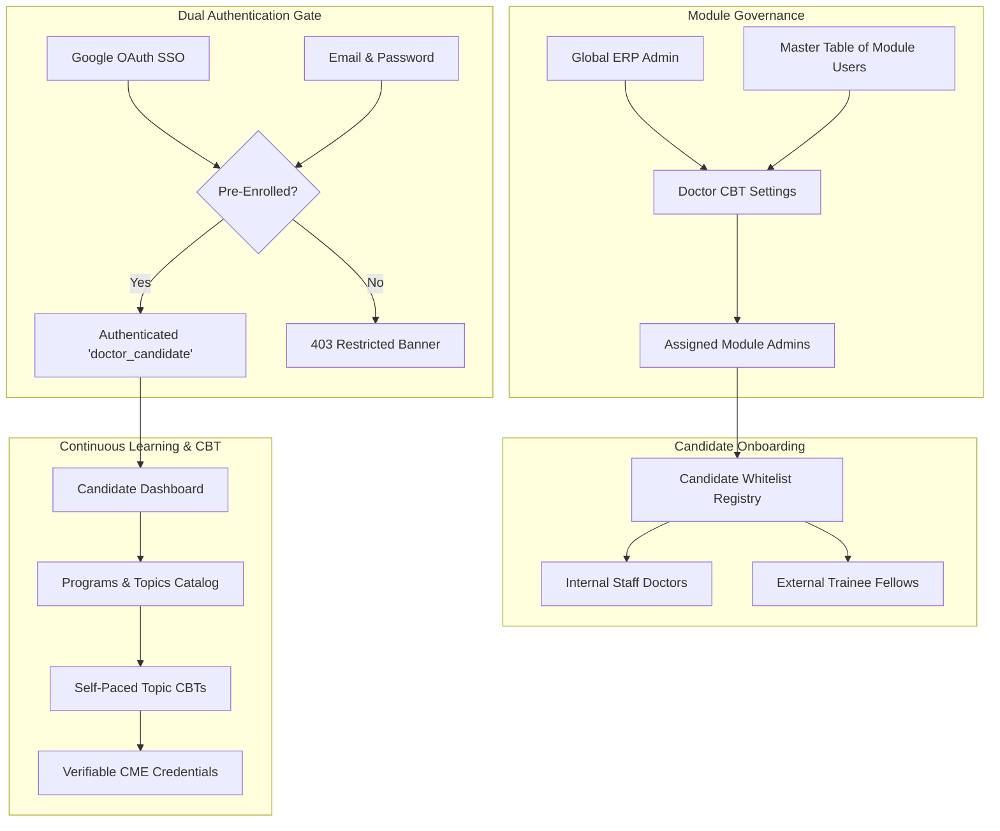
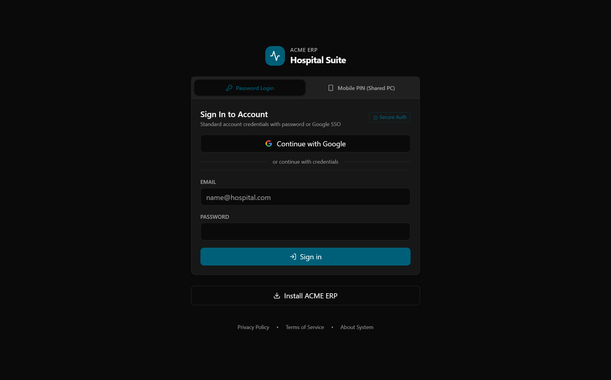
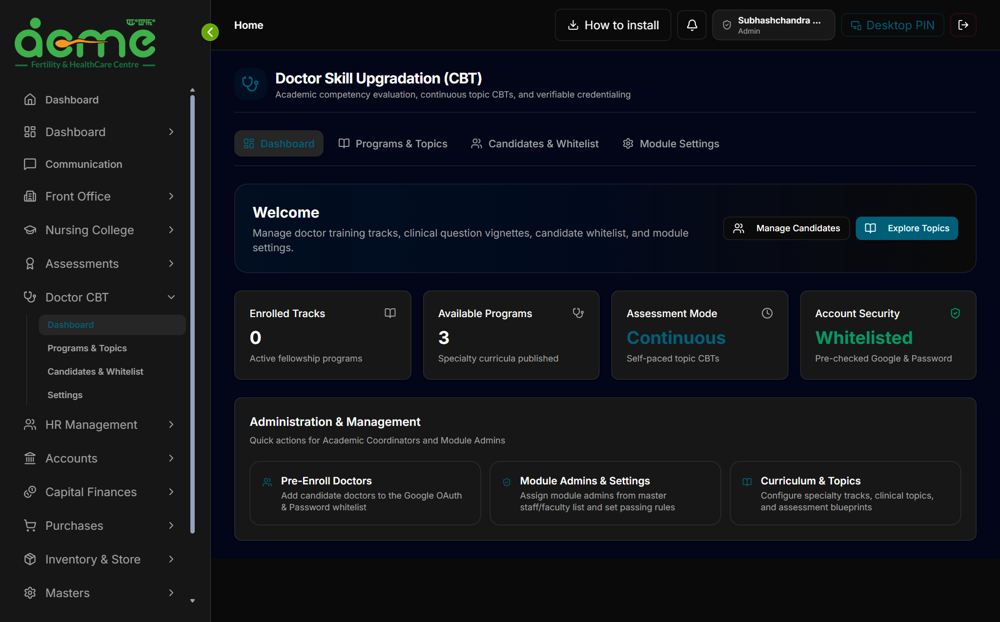
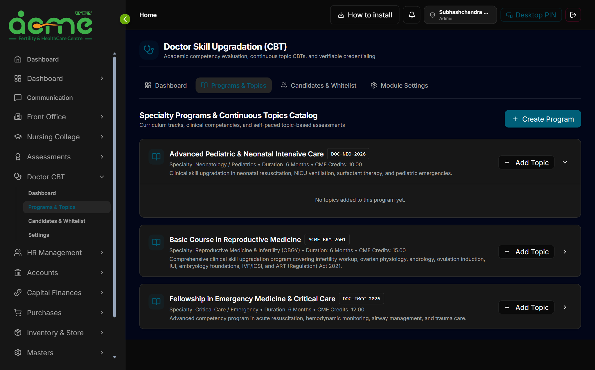
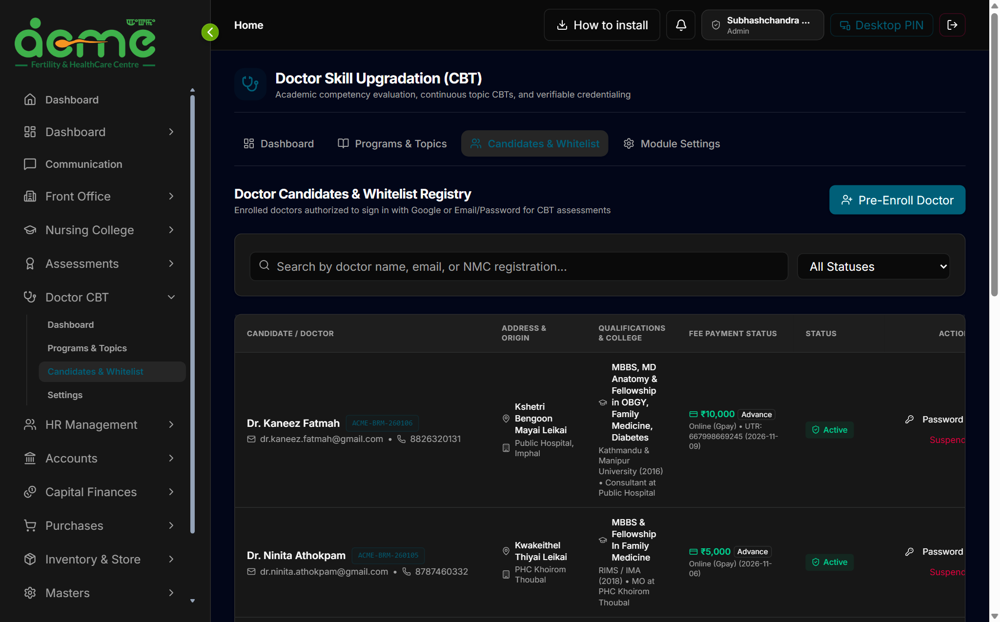
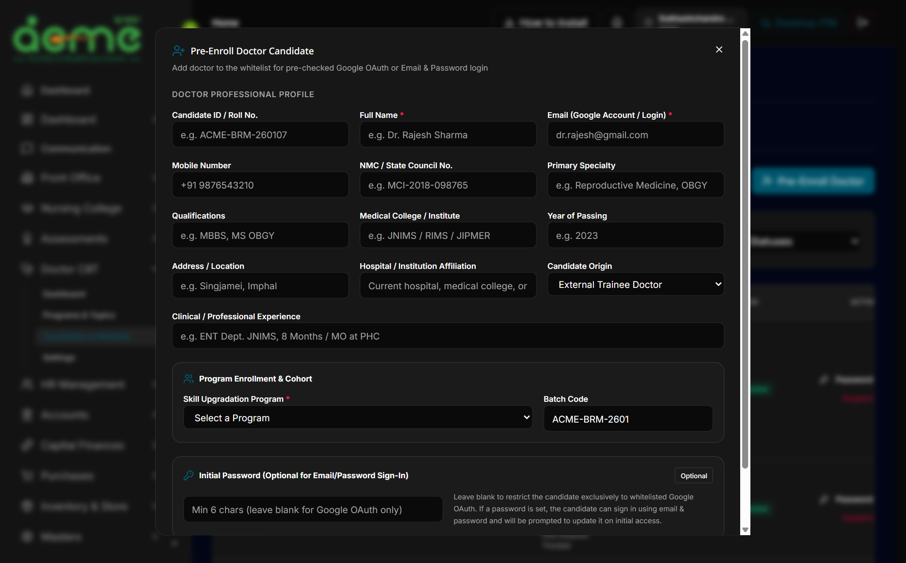
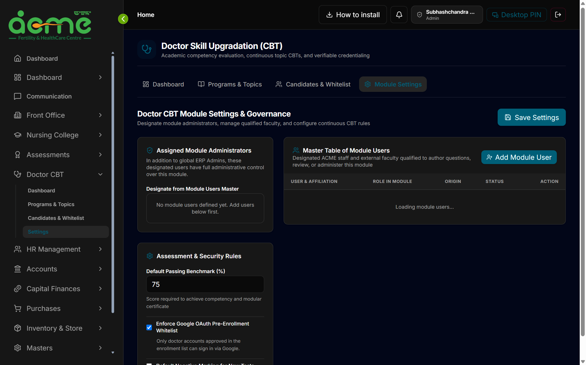
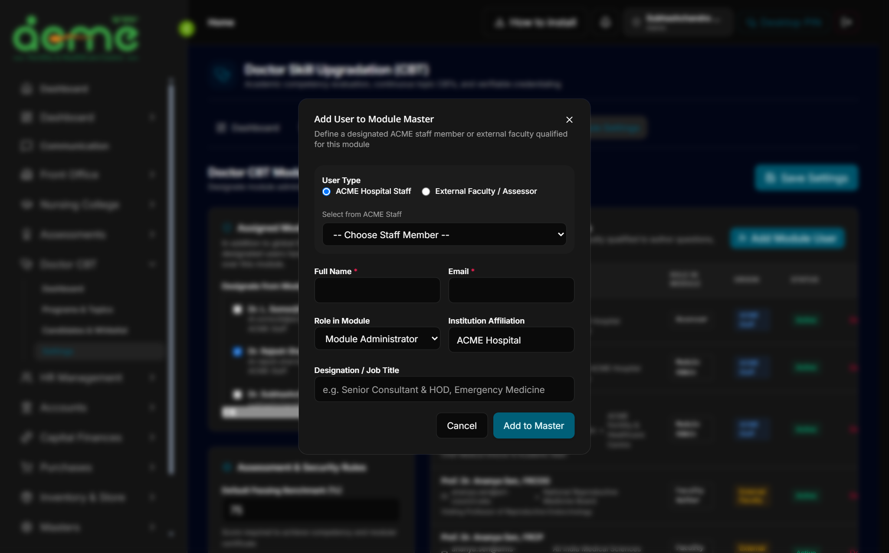

# Doctor Skill Upgradation (CBT) Module — Admin & User Guide

> **Module Location**: `/_authenticated/doctor-cbt`  
> **Target Audience**: Academic Directors, Training Faculty, Medical Coordinators, and Enrolled Candidate Doctors (Fellows, RMOs, Trainees)  
> **Database Schema**: `doctor_cbt`  
> **Version**: 1.0 (Phase 1 Foundation & Governance)

---

## 1. Overview & Architecture

ACME ERP operates a dedicated **Doctor Skill Upgradation (CBT) Module** engineered specifically for clinical skill enhancement, continuing medical education (CME), and objective competency verification for physicians, medical officers, and fellows.



### Key Differences: Staff CBT vs. Doctor Skill Upgradation CBT

| Feature | Nursing & Paramedical Staff CBT (`/assessments`) | Doctor Skill Upgradation CBT (`/doctor-cbt`) |
| :--- | :--- | :--- |
| **Audience** | Hospital nurses, technicians, ward attendants | Qualified medical practitioners (MBBS, MD/MS, DNB, Trainees) |
| **Identity Model** | Internal hospital `staff_id` only | Hybrid: Internal staff doctors + External enrolled fellows |
| **Authentication** | Employee Code + Password / Workstation PIN | **Google OAuth (Pre-Checked Whitelist)** + Email & Password |
| **Curriculum Flow** | Periodic NABH institutional standards | Specialty fellowship tracks, modular topics, CME credit hours |
| **Question Bank** | Standard compliance MCQs | Complex clinical vignettes, diagnostic imaging (ECG/CT/X-ray), lab panels |
| **Scoring Rules** | Fixed 80% passing mark | Configurable per topic (default 75%), optional negative marking (+1 / -0.25) |
| **Credentialing** | Internal NABH compliance printout | Verifiable CME completion certificates with candidate NMC / SMC registration |

---

## 2. Authentication & Access Security

The Doctor CBT module employs a **Pre-Enrolled Whitelist Gate** to protect institutional training materials and ensure only authorized candidates can access examinations.



### Authentication Channels

1. **Pre-Checked Google OAuth Single Sign-On (SSO)**:
   - Candidates click **"Continue with Google"** on the login screen.
   - Better-Auth verifies the Google account against the active enrollment whitelist in `doctor_cbt.doctor_profiles`.
   - **Authorized**: If the Gmail address is registered in an active program, the doctor is logged in immediately and directed to their training console.
   - **Unauthorized**: If the Google account is not pre-enrolled, the system blocks access with the advisory:  
     > *"This Google account is not enrolled in the ACME Doctor Skill Upgradation Program or hospital directory. Please contact the Academic Coordinator to enroll."*

2. **Email & Password Login Parity**:
   - Candidates can also authenticate using their registered email and password.
   - When administrators pre-enroll a doctor with a temporary initial password, the account is flagged with `mustChangePassword = true`. The candidate is prompted to set a secure private password upon first sign-in.

3. **Strict Candidate Sandboxing**:
   - Users with the `doctor_candidate` role are restricted exclusively to the Doctor CBT portal (`/doctor-cbt/*`).
   - Internal ERP operational modules (Hospital Accounts, Inpatient Billing, Pharmacy POS, Store Inventory, Staff Payroll, HR files) are hidden from the sidebar and blocked at the API level with `403 Forbidden`.

---

## 3. Candidate Experience Guide

### 3.1. Doctor CBT Dashboard

When an enrolled doctor signs in, they arrive at the **Doctor CBT Dashboard** (`/doctor-cbt`).



#### Dashboard Components:
- **Candidate Header**: Displays the physician's full name, State/National Medical Council registration number (e.g. `[NMC: NMC-2019-045812]`), and enrollment status badge.
- **KPI Summary Cards**:
  - **Enrolled Tracks**: Number of active fellowship programs assigned to the candidate.
  - **Available Programs**: Published specialty curricula open for learning.
  - **Assessment Mode**: Indicates continuous, self-paced competency evaluation.
  - **Account Security**: Confirms whitelisted verification status.
- **Your Enrolled Programs**: Lists assigned fellowship tracks with batch codes (e.g. `2026-Batch-A`), specialty description, and enrollment date, with a direct link to **"View Topics"**.

---

### 3.2. Programs & Clinical Topics Catalog

Navigating to **"Programs & Topics"** (`/doctor-cbt/programs`) presents the complete curriculum library.



#### How to Explore and Practice:
1. **Browse Specialty Programs**: Each program card displays the program code, title, duration, specialty category, and total CME credits awarded upon completion.
2. **Expand Curriculum Units**: Clicking any program card expands its clinical curriculum topics:
   - **Topic Code & Title**: e.g., `TOPIC-AIRWAY-01: Difficult Airway & Rapid Sequence Intubation`.
   - **CME Credits**: Credits earned upon passing the topic assessment (e.g., `2.00 CME Credit`).
   - **Clinical Scope**: Summary of key competencies (pre-oxygenation, LEMON score, RSI pharmacotherapy, surgical airway).
3. **Practice CBT**: Clicking **"Practice CBT"** launches the self-paced, timed clinical evaluation console for that topic.

---

## 4. Administrator & Coordinator Guide

Users with the `admin` role or designated as **Module Administrators** have full access to manage candidates, curricula, and module governance.

### 4.1. Managing the Candidate Whitelist Registry & Fee Ledger

Open **"Candidates & Whitelist"** (`/doctor-cbt/candidates`) to manage enrolled physicians and track fee reconciliation.



#### Key Directory Features:
- **Search & Filter**: Real-time filtering by doctor name, email address, or NMC registration number, with status filtering (`All`, `Enrolled`, `Active`, `Suspended`, `Alumni`).
- **Comprehensive Candidate Roster**:
  - **Candidate / Doctor**: Name, official Candidate ID badge (e.g. `ACME-BRM-260106`), primary email (Google login account), and mobile contact.
  - **Address & Origin**: Residential/clinic location (e.g., `Singjamei Chirom Leikai`, `Kshetri Bengoon Mayai Leikai`) and hospital/PHC posting.
  - **Qualifications & College**: Medical degrees (e.g. `MBBS, MS OBGY`), graduating institute/university (e.g. `JIPMER & RIMS`, `Kathmandu & Manipur University`), graduation year, and clinical experience.
  - **Fee Payment Status**: Aggregated amount received (e.g. `₹15,000`, `₹10,000`, `₹5,000`), payment terms (`1st Installment`, `Advance`), transaction mode (`GPay`, `PhonePe`), UTR/bank reference number, and payment date.
  - **Status Badge**: Green `Active` / `Enrolled` badge, or Red `Suspended` badge.
- **Inline Actions**:
  - **Password**: Opens a dialog to reset the candidate's temporary password.
  - **Suspend / Activate**: One-click toggle. Suspending a doctor immediately blocks their login session and revokes access until reactivated.

---

### 4.2. Pre-Enrolling a Doctor Candidate

To add an eligible physician to the Google OAuth and password whitelist, click **"Pre-Enroll Doctor"**.



#### Step-by-Step Pre-Enrollment:
1. **Candidate ID / Roll No.**: Enter assigned registration code (e.g. `ACME-BRM-260107`).
2. **Full Name**: Enter candidate name with prefix (e.g., `Dr. Kosinea Samom`).
3. **Email (Google Account / Login)**: The doctor's primary Gmail address or institutional email. This email is whitelisted for Google SSO.
4. **Mobile Number**: Contact mobile number for SMS/notifications.
5. **NMC / State Medical Council No.**: Formal regulatory registration number.
6. **Primary Specialty & Qualifications**: Enter degrees (e.g. `MBBS, MS OBGY`) and primary specialty.
7. **Medical College & Year of Passing**: Alma mater and graduation batch year.
8. **Address & Hospital Affiliation**: Residential location and current clinic/hospital posting.
9. **Clinical / Professional Experience**: Summary of previous clinical postings or department experience.
10. **Candidate Origin**: `External Trainee Doctor` or `Internal Hospital Staff Doctor`.
11. **Program & Batch Selection**: Choose the specialty program (e.g., `Basic Course in Reproductive Medicine`) and batch code (`ACME-BRM-2601`).
12. **Initial Password (Optional)**: If entered (min 6 characters), enables immediate email and password sign-in.
13. Click **"Complete Pre-Enrollment"**. The candidate is immediately added to the whitelist and can log in via Google or password.

---

### 4.3. Module Settings & Administration Delegation

Open **"Module Settings"** (`/doctor-cbt/settings`) to manage administrative roles and examination rules.



#### 1. Delegating Module Administrators:
- In addition to global ERP administrators, you can delegate full administrative authority over this module to specific clinical faculty or coordinators.
- Check the boxes next to designated staff or external faculty in the **"Assigned Module Administrators"** list.
- Click **"Save Settings"** to apply changes.

#### 2. Assessment & Security Rules:
- **Default Passing Benchmark (%)**: Minimum score required to earn competency certificates (default: `75%`).
- **Enforce Google OAuth Pre-Enrollment Whitelist**: Ensures only pre-approved emails can log in via Google SSO.
- **Default Negative Marking**: Optional toggle to enable penalty scoring (e.g., `-0.25` deduction per incorrect answer) for high-stakes test blueprints.

---

### 4.4. Master Table of Module Users

The right pane of the Settings page houses the **Master Table of Module Users**.



This registry maintains the pool of clinical experts qualified to manage or teach in the module:
- **ACME Hospital Staff**: Senior consultants, HODs, and medical superintendents linked from the internal staff directory.
- **External Faculty / Assessors**: Guest professors, national board examiners, and visiting clinical faculty.
- **Assigned Module Roles**:
  - `Module Administrator`: Full administrative rights over candidates, settings, and curriculum.
  - `Faculty Question Author`: Permitted to author clinical case vignettes and questions.
  - `Clinical Assessor`: Authorized to evaluate practical OSCEs and review performance.

To add new faculty, click **"Add Module User"**, choose between **ACME Staff** (auto-populating from staff directory) or **External Faculty**, define their role, and click **"Add to Master"**.

---

## 5. Development Data & Verification Reference

The development database is pre-seeded with realistic clinical data for testing all workflows.

### 5.1. Seeded Specialty Programs & Topics

| Program Code | Program Title | Specialty | Topics Included | Total Credits |
| :--- | :--- | :--- | :--- | :--- |
| `DOC-EMCC-2026` | **Fellowship in Emergency Medicine & Critical Care** | Critical Care / Emergency | • `TOPIC-AIRWAY-01`: Difficult Airway & RSI<br>• `TOPIC-SHOCK-02`: Septic Shock & Hemodynamics<br>• `TOPIC-TRAUMA-03`: ATLS & Massive Transfusion<br>• `TOPIC-POCUS-04`: Point-of-Care Ultrasound | 12.00 CME |
| `DOC-NEO-2026` | **Advanced Pediatric & Neonatal Intensive Care** | Neonatology / Pediatrics | • Neonatal Resuscitation & NRP Guidelines<br>• NICU Mechanical Ventilation<br>• Pediatric Sepsis Protocols | 10.00 CME |

---

### 5.2. Seeded Candidate Accounts (For Verification)

| Candidate Name | Login Email | Medical Reg (NMC) | Origin & Specialty | Status | Password |
| :--- | :--- | :--- | :--- | :--- | :--- |
| **Dr. Neha Verma** | `dr.neha.verma@gmail.com` | `NMC-2019-045812` | External (Apollo Hospitals) • Critical Care | **Active** | `Doctor@1234` |
| **Dr. Amitav Choudhury** | `dr.amitav@gmail.com` | `MMC-2020-089123` | External (Fortis Escorts) • Emergency Med | **Active** | `Doctor@1234` |
| **Dr. Kh. Ibomcha Meitei** | `ibomcha.rmo@acmehospital.com` | `SMC-MAN-2022-0056` | Internal Staff • Resident Medical Officer | **Enrolled** | `Doctor@1234` |
| **Dr. Sameer Khan** | `sameer.khan.blocked@gmail.com` | `DMC-2018-091244` | External • General Practice | **Suspended** | `Doctor@1234` *(Blocked)* |

---

### 5.3. Seeded Module Users (Faculty & Administrators)

| Name & Title | Email | Role in Module | Affiliation |
| :--- | :--- | :--- | :--- |
| **Dr. Rajesh Sharma, MD** | `dr.rajesh.sharma@acmehospital.com` | **Module Administrator** | ACME Hospital • HOD Critical Care |
| **Prof. Dr. Ananya Sen, FRCP** | `ananya.sen@aims-external.edu` | **Faculty Question Author** | All India Medical Sciences Council • Adjunct Professor |
| **Dr. L. Somorjit Singh, MS, MCh** | `dr.somorjit@acmehospital.com` | **Clinical Assessor** | ACME Hospital • Trauma Directorate Lead |

---

## 6. Operational Checklist

```
[ ] Step 1: Pre-enroll doctor candidate via Candidates page or bulk import
[ ] Step 2: Candidate signs in via "Continue with Google" or Email + temporary password
[ ] Step 3: Candidate explores enrolled specialty track and clicks "Practice CBT"
[ ] Step 4: Candidate answers case vignettes, reviews evidence-based rationales
[ ] Step 5: Achieving >= 75% issues an instant modular certificate with verifiable QR code
[ ] Step 6: Coordinator tracks cohort performance and exports accreditation rosters
```

---

## 7. Production Deployment & Seeding Guide

### 7.1. Database Schema Deployment (Automatic)
The `doctor_cbt` schema and all 12 tables are automatically applied during deployment.
In `docker-entrypoint.sh`, the standard `pnpm db:setup` command executes `server/db/setup-doctor-cbt-db.ts`:
```bash
# Executed automatically on Docker container startup, or run manually:
pnpm doctor-cbt:setup
# (or: npx tsx server/db/setup-doctor-cbt-db.ts)
```
- Creates PostgreSQL schema `"doctor_cbt"`
- Creates 12 module tables with strict foreign keys and performance indexes
- Initializes default module settings (`default_pass_percentage: 75%`, `enable_google_whitelist: true`) idempotently.

---

### 7.2. Deploying Curriculum & Candidate Data in Production

To seed or update the **Basic Course in Reproductive Medicine** curriculum, 10 clinical modules, 50 exam MCQs, pre/exit blueprints, and the candidate directory in production:

#### Via Docker Compose (Recommended)
Run inside the running `web` container:
```bash
docker compose exec web pnpm doctor-cbt:seed
```

#### Direct Server Execution (VM / Bare Metal / Railway)
```bash
pnpm doctor-cbt:seed
# (or: npx tsx server/db/seed-doctor-cbt-dev.ts)
```

> [!NOTE]
> **Idempotent & Safe**: `doctor-cbt:seed` checks for existing records by unique code/email (`ON CONFLICT` / upsert) and will **never** wipe existing hospital records, clinical data, or closing accounts.

---

### 7.3. Google OAuth Production Configuration
To enable passwordless one-click sign-in for doctor candidates in production:
1. Ensure your production `.env` or Docker environment contains:
   ```env
   GOOGLE_CLIENT_ID=your-google-oauth-client-id.apps.googleusercontent.com
   GOOGLE_CLIENT_SECRET=GOCSPX-your-google-client-secret
   BETTER_AUTH_URL=https://my-acme.cloud
   TRUSTED_ORIGINS=https://my-acme.cloud
   ```
2. In [Google Cloud Console](https://console.cloud.google.com/apis/credentials):
   - Add your production redirect URI:
     `https://my-acme.cloud/api/auth/callback/google`
3. Candidates whose email appears in `doctor_cbt.doctor_profiles` (or `doctor_cbt.module_users`) can immediately sign in with one click via **Continue with Google**.

